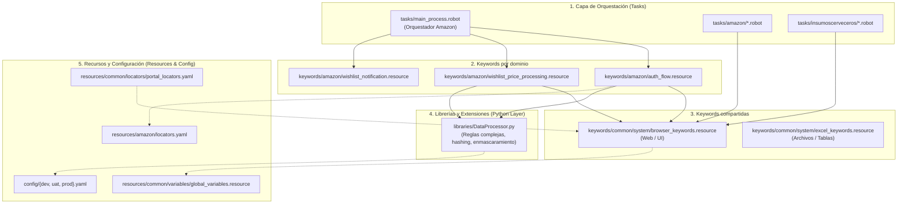

# Arquitectura de Automatización RPA con Robot Framework

## 1. Visión General y Filosofía de Diseño
Este proyecto sigue una **Arquitectura en Capas (Layered Architecture)** orientada a procesos de RPA (*Robotic Process Automation*), diseñada bajo estándares de ingeniería de software y directrices de calidad de software alineadas a **ISTQB**.

El objetivo principal es garantizar:
- **Mantenibilidad:** Separación estricta entre la orquestación del proceso, la lógica del negocio y la interacción técnica con los sistemas.
- **Resiliencia y Tolerancia a Fallos:** Manejo diferenciado de excepciones técnicas (*System Exceptions*) vs inconsistencias de datos (*Business Exceptions*).
- **Idempotencia y Trazabilidad:** Capacidad de reanudar o auditar el procesamiento sin duplicar transacciones.
- **Agilidad para QA y Desarrollo:** Facilita la identificación de la causa raíz de cualquier defecto para su pronta resolución.

---

## 2. Diagrama de Arquitectura en Capas

---

## 3. Descripción de las Capas

### A. Capa de Tareas (`tasks/`)
- Es el punto de entrada de la automatización.
- Utiliza sintaxis declarativa y lenguaje cercano al negocio (*Keyword-Driven*).
- Contiene los ganchos de ciclo de vida (`Suite Setup`, `Suite Teardown`, `Test Setup`, `Test Teardown`).
- **Regla:** No debe contener selectores XPath, CSS ni llamadas directas de bajo nivel (como `Click Element` o `Input Text`).

### B. Keywords específicas por sitio (`keywords/<sitio>/`)
- Modelan flujos y reglas propias del portal, por ejemplo la autenticación, el procesamiento y las métricas de la wishlist Amazon.
- Cada nuevo sitio debe tener su propia carpeta para evitar dependencias y cambios cruzados.
- Implementa bloques `TRY / EXCEPT` para clasificar fallos:
  - **Excepción de Negocio (`Business Exception`):** Registro no cumple reglas (ej. saldo insuficiente, campo faltante). No se reintenta; se registra y se continúa con el siguiente ítem.
  - **Excepción de Sistema (`System Exception`):** Falla en la aplicación, timeout, pantalla congelada. Se capturan evidencias (captura de pantalla, logs de red) y se evalúa política de reintentos (*retry policy*).

### C. Keywords compartidas (`keywords/common/system/`)
- Abstracción de interacción técnica directa con aplicaciones (Web, Desktop, SAP, API, Excel, PDF, Correo).
- Implementa esperas explícitas (*Explicit Waits*), validaciones de visibilidad y manipuladores de diálogos.
- Protege a la lógica de negocio frente a cambios menores en el comportamiento de los motores de automatización.

### D. Capa de Extensiones en Python (`libraries/`)
- Se reserva para operaciones donde Robot Framework resultaría verboso o ineficiente:
  - Validación de estructuras de datos complejas o expresiones regulares.
  - Manipulación avanzada de fechas y conversiones de tipos.
  - Enmascaramiento y sanitización de datos sensibles (PII).
  - Carga dinámica y validación de esquemas YAML/JSON.

### E. Recursos y Configuración (`resources/` y `config/`)
- **`config/{env}.yaml`:** Ajustes específicos para DEV, UAT y PROD (URLs, timeouts, switches de modo headless, credenciales/vaults).
- **`resources/<sitio>/`:** Localizadores, variables y recursos propios de cada portal. Por ejemplo, Amazon usa `resources/amazon/locators.yaml`.
- **`resources/common/`:** Configuración de librerías, variables globales y recursos genéricos reutilizables.

### F. Gestión de Datos (`data/`)
- `data/input/`: Archivos de insumo pendientes de procesar.
- `data/output/`: Archivos procesados o generados por el robot.
- `data/temp/`: Archivos temporales generados durante la ejecución.
- **Nota:** Todo contenido en estas carpetas está excluido de control de versiones vía `.gitignore` para salvaguardar la confidencialidad de la información.

---

## 4. Estrategia de Calidad y Pruebas (Enfoque ISTQB)

Para garantizar la estabilidad del robot en ambientes productivos:
1. **Pruebas Estáticas:** Uso de `robocop` (linter) y `robotidy` (formateador) en los pipelines de CI/CD.
2. **Pruebas Unitarias de Keywords:** Validación individual de keywords de negocio usando datos simulados (*mock data*).
3. **Pruebas de Resiliencia / Inyección de Fallos:** Inyectar registros erróneos (como en `data/input/orders_sample.csv`) para comprobar que el robot continúa procesando el lote sin caerse.
4. **Trazabilidad y Reporte de Defectos:** Documentación clara de incidentes mediante el formato estándar de QA en `docs/QA_DEFECT_TEMPLATE.md` para facilitar la remediación ágil por parte del desarrollador (`@Agent: Ralph_Developer`).
